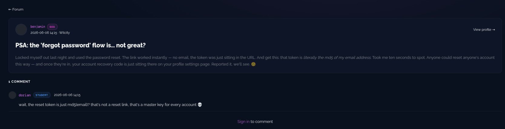
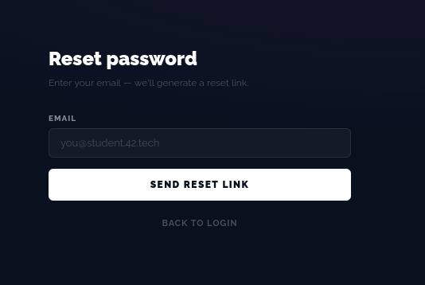

# 1 - RESET PASSWORD

## qu'est ce que c'est

la faille provient d'une faille au niveau du token, n'importe qui peut obtenir ce token et donc l'adresse mail, 
Le jeton est renvoyé à l’utilisateur au lieu d’être envoyé par mail. Si le lien fonctionne instantanément sans e-mail, c’est que l’étape de preuve de possession est supprimée. Le serveur donne la clé à la personne qui la demande, sans vérifier qui elle est.

## comment acceder au flag

En regardant dans le forum benjamin parle d'une faille,

il faut juste mettre mot de passe oublie, mettre le mail du student, changer le mot de passe et se connecter via le nouveau mot de passe

apres etre connecte sur le compte du student le flag sera dans son profil lorsque l'on va dans editer

## comment solutionner le probleme

Utiliser un système de cryptage plus sécurisé, rajouter une double authentification, limiter la durée de vie et le nombre de requêtes en cas de tentatives de brut force.