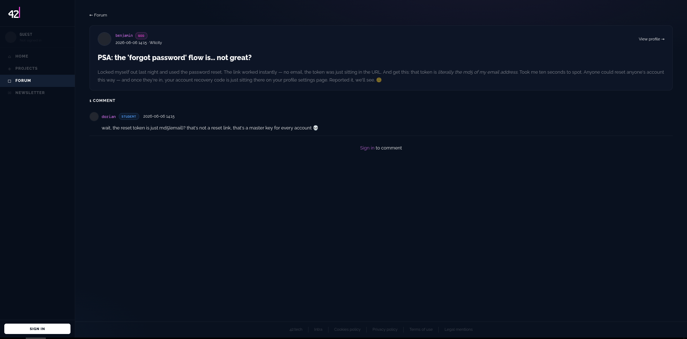
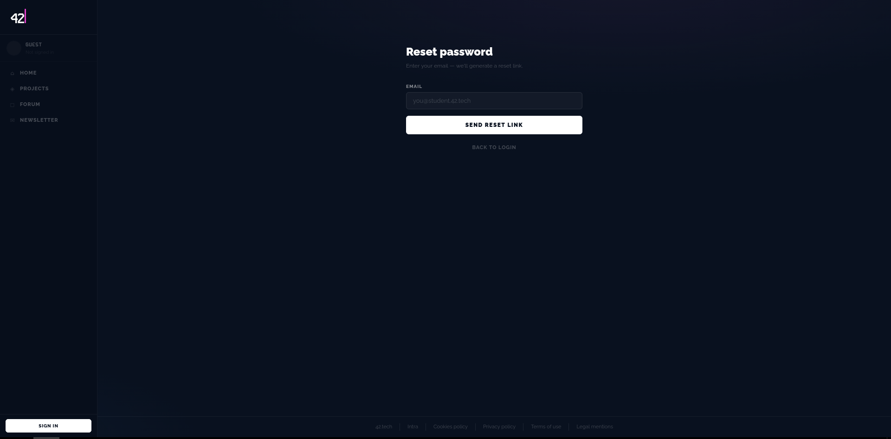

# 1 - RESET PASSWORD

## qu'est ce que c'est

blahblahblah

## comment acceder au flag

En regardant dans le forum benjamin parle d'une faille,

    

il faut juste mettre mot de passe oublie, mettre le mail du student, changer le mot de passe et se connecter via le nouveau mot de passe

    

## comment solutionner le probleme

Utiliser un système de cryptage plus sécurisé, rajouter une double authentification, limiter la durée de vie et le nombre de requêtes en cas de tentatives de brut force.