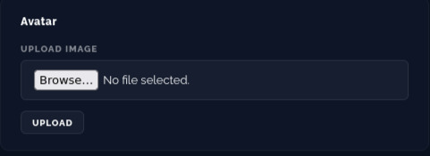

# 2 - MALICIOUS FILE UPLOAD

## what is it

This is what is known as a "malicious file upload" leading to RCE (Remote Code Execution), via command injection once the file is executed. It is one of the most critical vulnerabilities, as it gives direct access to the server, not just to the data.

## how to access the flag

After logging into the account, it is enough to upload a PHP script in the profile picture upload section to obtain the flag.

Test code in a PHP file:

```php
<?php echo system('id'): ?>
```



## how to fix the problem

Verify the file type (there is no need for a PDF for a profile picture), and verify the file content (especially the header).