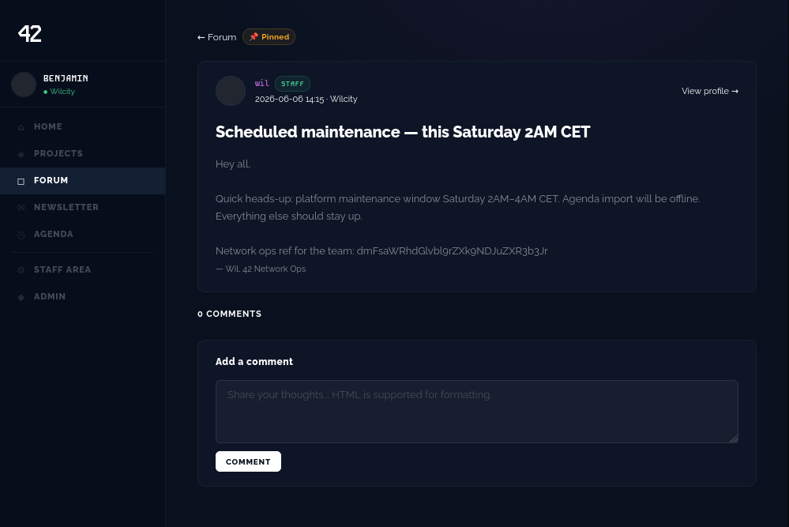
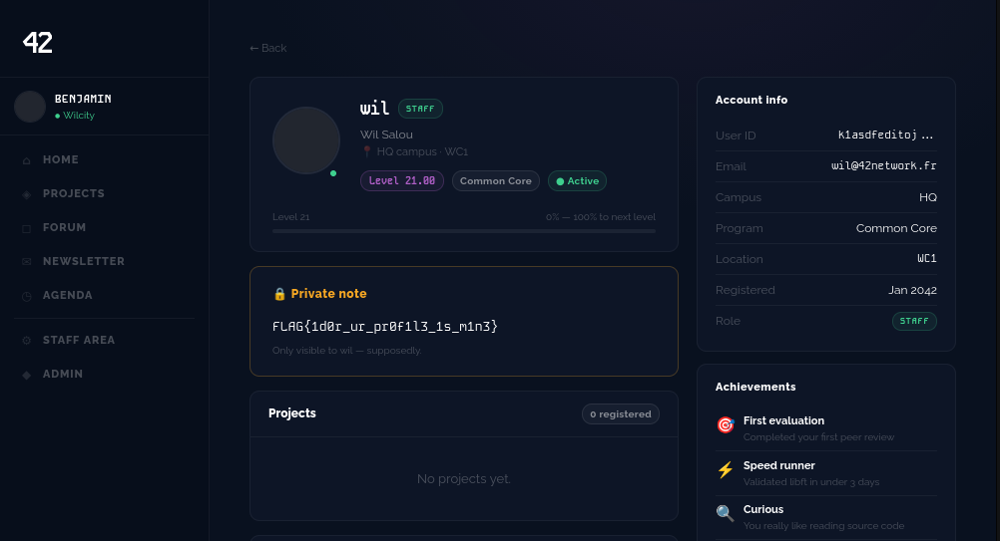

# 3 - IDOR PRIVATE NOTES

## qu'est ce que c'est

blahblahblah

## comment acceder au flag

Sans etre connecte sur le compte d'un utilisateur, on peux acceder aux notes prives d'un membre du staff du site.

dans le forum, un membre du staff (wil) a mit un message parlant d'une maintenance, il suffit de voir son profil pour acceder au flag

## comment solutionner le probleme

Toujours vérifier les autorisations côté serveur et surveiller les fonctions les plus sensibles.