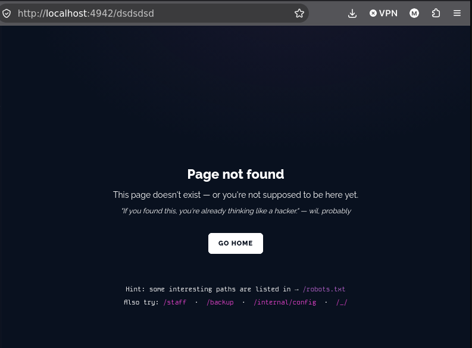
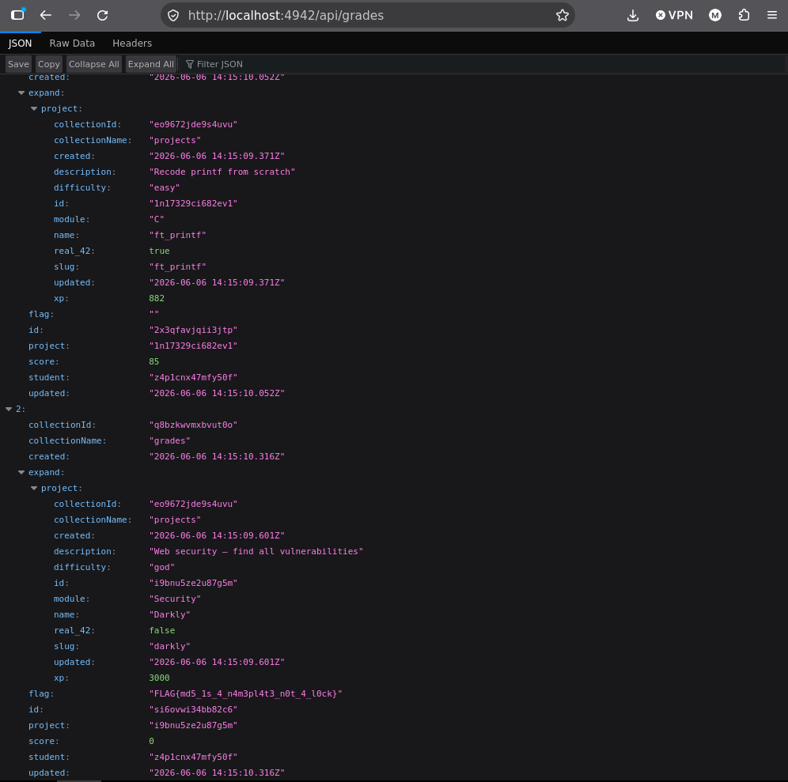

# 4 API PROJECTS ACCESS

## qu'est ce que c'est

blahblahblah

## comment acceder au flag

en etant connecte a un utilisateur student, on peux acceder en trouvant des indices donnes dans le projet dont robots.txt lorsque l'on met un invalid path.

en allant sur /api/grades et en regardant un peu les informations, on trouve un nouveau flag

 

## comment solutionner le probleme

Bloquer l'accès à ceux qui ne devraient pas l’avoir (via une clé, un rôle protege comme il faut etc)