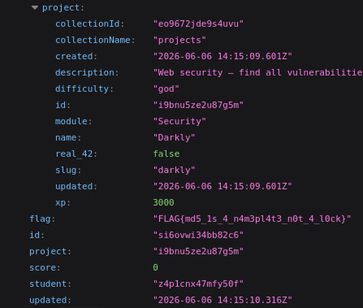

# 4 API ENDPOINT ACCESS

## what is it

An API exposes access points (endpoints) that allow data to be read or modified. An unprotected endpoint is a route that executes an action or returns data without checking whether the caller has the right to do so, or even without verifying who the caller is at all.

This is an access control vulnerability, closely related to IDOR: IDOR concerns which specific resource you can access, while an unprotected endpoint concerns whether you can call the route at all.

## how to access the flag

When logged in as a student user, access is possible by finding clues in the project, including robots.txt when an invalid path is used.

By going to /api/grades and taking a closer look at the information, a new flag is found.

## how to fix the problem

Block access for those who should not have it (through a key, a properly protected role, etc.).