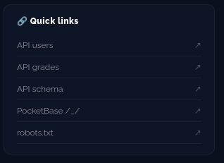
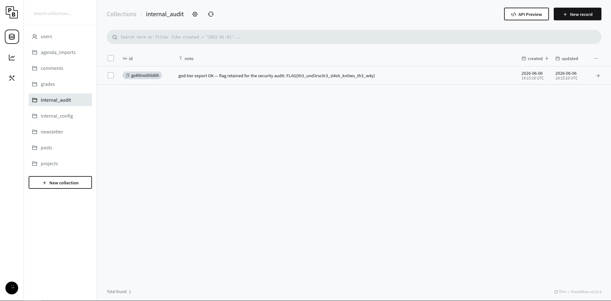

# 7 - GOD PERMISSIONS ON DATABASE

## qu'est ce que c'est

L’élévation de privilèges, ce n’est pas une technique d’attaque précise — c’est un objectif : obtenir des droits plus élevés que ceux normalement accordés. C’est souvent la conséquence d’une autre faille (mass assignment, IDOR, endpoint non protégé, injection...) plutôt qu’une catégorie technique à part.

## comment acceder au flag

maintenant que l'on a les logs admin grace a l'injection XML, on peut se log sur http://localhost:8090/_/ grace au dashboard qui nous donne cette information

en nous connectant graces aux logs admins, on accede a la database, on peut ensuite s'octroyer les permissions totale en mettant notre profil en "god" et modifier ce que l'on veux, en allant sur la table "internal_audit" on tombe directement sur le flag

## comment solutionner le probleme

Well, mostly the same as xml since the breach comes from it, but also prevent the server from accessing sensible data from xml files.