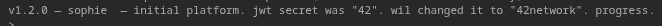

# 1 - JSON Web Token in comments

## What is it

The breach comes from the different comments that are found in the website console, in the html page, we learn that the JWT changed from '42' to '42network'

## How to fix it

Remove the comments from the file (at least the one about the change)