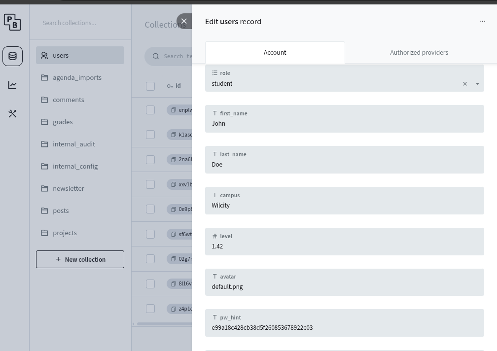

# 3 Bad password + leaked md5 hash

## What is it

The breach comes the fact that passwords can be really weak and so easy to find, it is not helped by the fact that the md5 is leaked in Pocket Base (you can see the password hash), anyone having access to it can brut force the hash to find the source password.

## How to fix it

Make the user use a better and not easy to find password, change the hashing system from md5 to something difficult to trace.